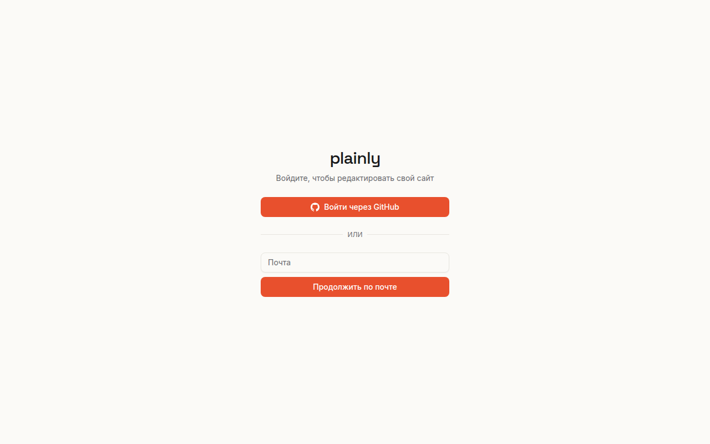

# Plainly

Plainly is a content editor for the owner of a static site. The interface is in Russian. You sign in with email or GitHub, edit the content described in the site's `.pages.yml`, and Plainly commits the change to that site's GitHub repository. Photos are reduced and saved as WebP in the browser before they are uploaded.



The screenshot is the sign-in page from a local run. Editing a repository also needs a GitHub App on your own GitHub account. That step is described below, and it cannot be finished without those credentials.

## Quick start

These steps were run on a clean clone with Node.js 22 and PostgreSQL 16 on Ubuntu 24.04.

Install dependencies:

```bash
npm ci
```

Create a PostgreSQL 16 database that matches `DATABASE_URL` in `.env.example` (`plainly` / `plainly` on `127.0.0.1:5432`). On Ubuntu 24.04 the commands are:

```bash
sudo apt-get install -y postgresql
sudo pg_ctlcluster 16 main start
sudo -u postgres psql -c "CREATE USER plainly WITH PASSWORD 'plainly' LOGIN;"
sudo -u postgres psql -c "CREATE DATABASE plainly OWNER plainly;"
```

`pg_ctlcluster` is only needed when the package does not start the server itself. If the role or database already exists, skip the command that would create it again.

Copy the environment template and replace `BETTER_AUTH_SECRET` and `CRYPTO_KEY` with long random strings. `.env.local` stays uncommitted.

```bash
cp .env.example .env.local
```

The placeholder GitHub values are enough to open the sign-in page. To edit a real repository, create a GitHub App and let the helper write its credentials into `.env.local`:

```bash
npm run setup:github-app -- --base-url http://localhost:3000 --env .env.local --no-open
```

The helper prints a GitHub URL. Open it, create the app, install it on the repository you want to edit, then start the dev server again. Useful options: `--owner-type personal|org`, `--org <slug>`, `--app-name "Plainly (local)"`.

Apply the migrations and start the app:

```bash
npm run db:migrate
npm run dev
```

Open http://localhost:3000/sign-in. Success is the Plainly mark, the sentence "Войдите, чтобы редактировать свой сайт", a GitHub button, and an email field.

`npm run build` compiles the app and then applies the same migrations (`postbuild`). It needs `DATABASE_URL` and `BASE_URL`. It does not call GitHub. This repository has no automated test suite. GitHub Actions runs `npm ci` and `npm run build` against PostgreSQL 16, with placeholder GitHub App values, because those credentials are private and the build does not use them.

## Stack

Next.js App Router, TypeScript, better-auth (email one-time code and GitHub), Drizzle ORM, PostgreSQL, a GitHub App (`@octokit/app` and `@octokit/rest`), TipTap, CodeMirror, Resend or SMTP, and a Vercel project config.

## Status

November 2026. Plainly is a public fork of [Pages CMS](https://pagescms.org) by Ronan Berder. The local changes are the Plainly name, the Russian interface, and client-side image downscaling to WebP before upload.

## Licence

[MIT](LICENSE). Copyright 2025 Ronan Berder and copyright 2026 Gleb Starchikov. Copies keep both copyright notices, as the MIT terms require.
